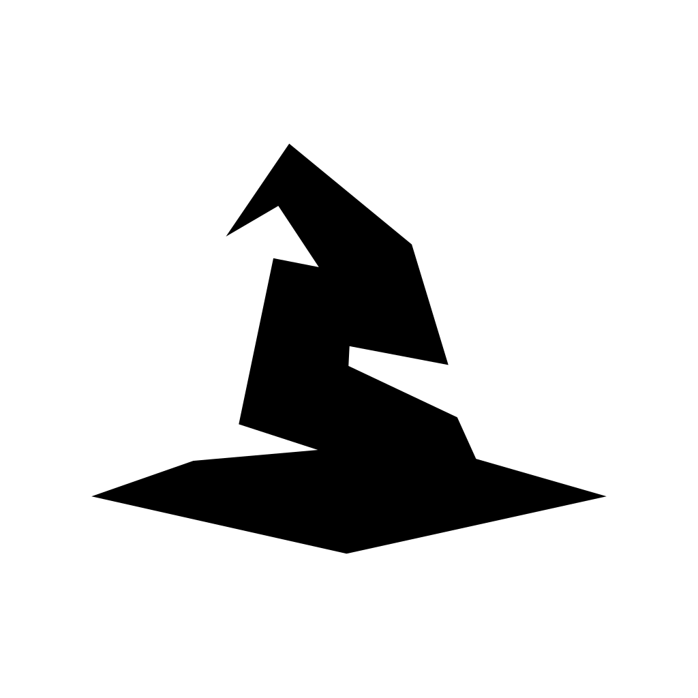

<p align="center"></p>

# CapWizard

Monta reel verticali in CapCut partendo da una cartella di clip, con le regole di
ogni cliente.

**Il montaggio lo fa Claude Code.** «Genera» avvia il Claude Code del Mac (`claude -p`,
con il login dell'utente) con la skill `reel-capcut-mac` e il profilo del cliente
scelto. Claude analizza le clip, decide i tagli, scrive il progetto CapCut e lo
verifica; l'app mostra i suoi messaggi e l'avanzamento a passi. Le correzioni (testo o
screenshot della chat del cliente) vengono fatte sullo stesso progetto, e la lezione
finisce nel profilo del cliente. Vedi [agent.py](src/capwizard_app/agent.py).

- **Skill `reel-capcut-mac`** (`~/.claude/skills/reel-capcut-mac`): regole di montaggio,
  script (analisi con Whisper, controllo dei tagli, costruzione e verifica del draft),
  procedura delle correzioni.
- **Profilo cliente**: una skill `reel-<cliente>` (es. `reel-chirone`) con
  `metadata: capwizard-template: …` oppure che nomina il suo `TEMPLATE …`. Kit, volumi,
  girato tipico e «## Lezioni» del cliente.

### Senza interfaccia

Le stesse skill funzionano da sole in Claude Code: da un terminale

```bash
claude
```

e poi, per esempio, «monta il reel della cartella ~/Downloads/VIDEO/3 per Chirone» o
«correggi il reel X: <richiesta o screenshot>». Da terminale la skill registra il
progetto e le correzioni con `scripts/registra.py`, così compaiono anche nell'app.

## Setup

```bash
python3 -m venv .venv
.venv/bin/pip install -e .
```

Servono Claude Code con il login fatto (`claude` → `/login`) e la skill
`reel-capcut-mac` installata (vedi il suo `LEGGIMI.md`: ffmpeg, mlx-whisper).

## App desktop (Electron) — nuova UI

La UI in-app è stata rifatta come **app desktop Electron** con backend Python.

```
desktop/                    # guscio Electron
├── electron/
│   ├── main.js             # crea la finestra, lancia il backend Python come sidecar
│   └── preload.js          # espone i dialog nativi al renderer
└── renderer/               # UI (HTML/CSS/JS, dark theme)
    ├── index.html
    ├── styles.css
    └── app.js              # parla col backend via REST + WebSocket
```

Il backend è un server **FastAPI** ([server.py](src/capwizard_app/server.py)) che avvia
Claude Code e ne trasmette i messaggi; espone:
- `GET /api/health` · `GET /api/system` · `GET /api/templates`
- `POST /api/generate` → avvia un job, ritorna `job_id`
- `WS /api/ws/jobs/{job_id}` → stream dei log in tempo reale
- `GET /api/projects` · `GET /api/projects/{id}` · `DELETE /api/projects/{id}`
- `GET /api/ai/status` · `POST /api/ai/test`

### Modalità locale (uso privato, senza login)

In `desktop/renderer/app.js` c'è `const LOCAL_MODE = true;`: con `true` l'app
salta login e controllo abbonamento e parte diretta sulla Home — per uso privato
finché il backend cloud non è configurato. Mettilo a `false` per attivare il gate
SaaS.

### Modalità blocco (batch)

Nell'editor c'è il toggle **"Modalità blocco"**: scegli una **cartella madre** e
ogni sottocartella che contiene video diventa un progetto separato, tutti con lo
stesso template, stile sottotitoli e preferenze. Il nome di ogni progetto è il
nome della sottocartella (con un prefisso opzionale). Endpoint:
`GET /api/subfolders?path=…` (anteprima) e `POST /api/batch`.

### Schermate

- **Home** — griglia dei progetti creati dal programma (registro in
  [registry.py](src/capwizard_app/registry.py), salvato in app-data). Ogni card ha
  *Apri* (in Finder/Explorer) e *Duplica*.
- **Duplica** — riapre l'editor pre-riempito con tutte le impostazioni del
  progetto: basta cambiare le clip / qualche preferenza e rigenerare.
- **Editor** — il form di generazione + console log in tempo reale.
- **Wizard AI** — procedura guidata (Stato → Setup → Test) che rileva il
  `claude` CLI, spiega come configurarlo e testa la connessione.

### Sviluppo

```bash
# 1. backend Python (una volta)
python3 -m venv .venv
.venv/bin/pip install -e .

# 2. app desktop
cd desktop
npm install
npm start        # lancia Electron, che a sua volta avvia il backend
```

In dev, `main.js` lancia il backend con l'interprete della `.venv`. Nella build
impacchettata userà un sidecar PyInstaller in `resources/backend/` (da fare).

### Distribuzione (TODO)

- Sidecar Python via **PyInstaller** (un binario per OS)
- `ffmpeg` e skill `reel-capcut-mac` installati al primo avvio
- `electron-builder` → `.dmg` (Mac) + `.exe`/NSIS (Windows)
- Code signing: Apple Developer ID + notarization; certificato Windows
- Auto-update

## Architettura Python

```
src/capwizard_app/
├── server.py       # backend FastAPI per Electron (REST + WebSocket)
├── agent.py        # avvia Claude Code con la skill e il profilo cliente, correzioni e lezioni
├── capcut.py       # cartella dei progetti CapCut, ricerca di `claude`, kit di un template
└── registry.py     # registro dei progetti creati (app-data)
```

## Note di fragilità

Il formato `.draft` di CapCut non è ufficiale: i progetti si costruiscono clonando lo
schema dal template del cliente, fatto con la tua versione di CapCut. Se aggiorni CapCut e qualcosa rompe, di solito basta
ricreare il draft template nella nuova versione di CapCut e rilanciare.
